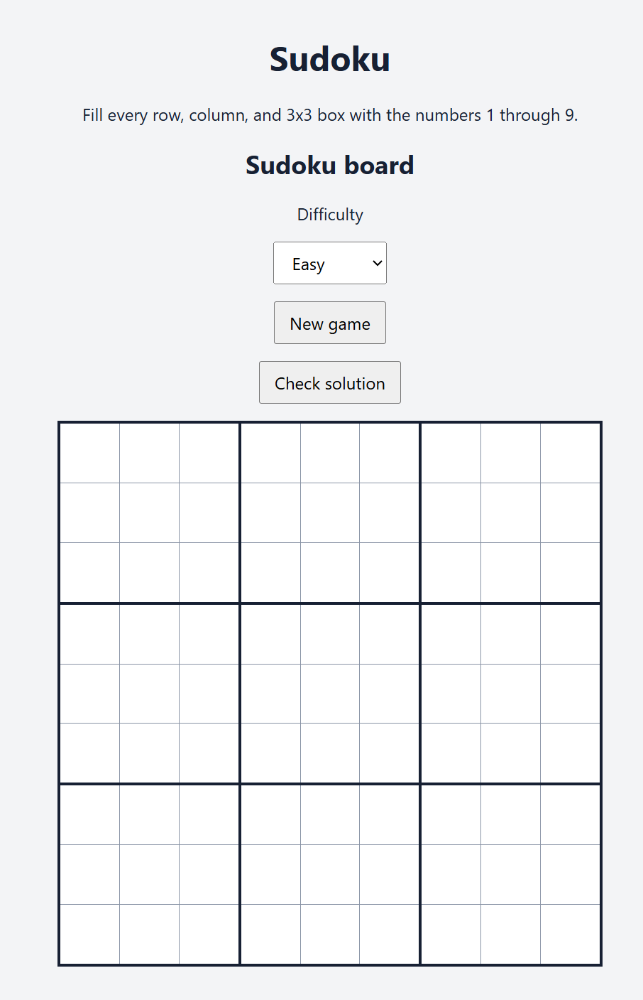
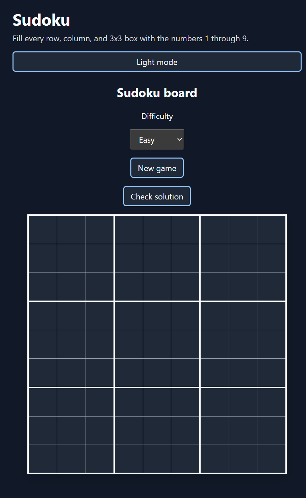
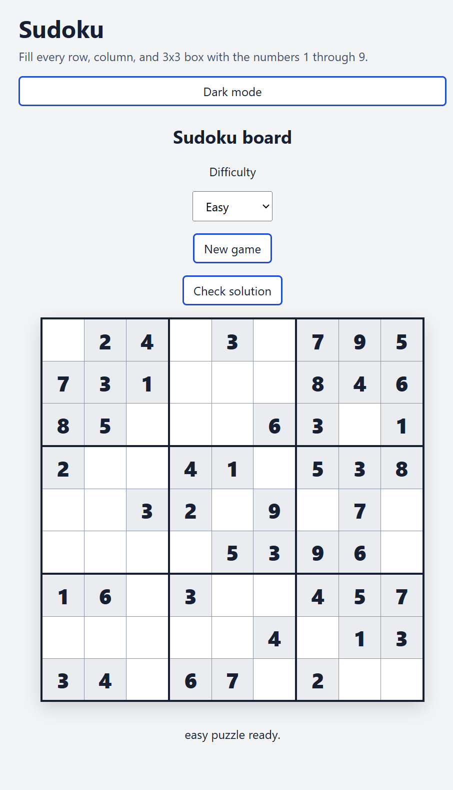
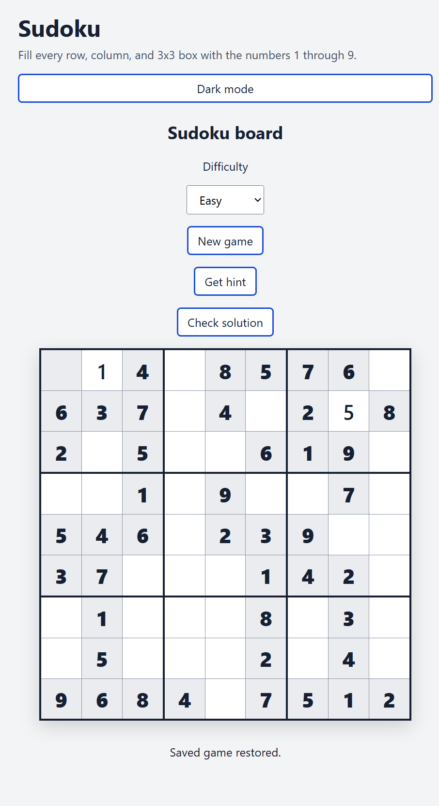
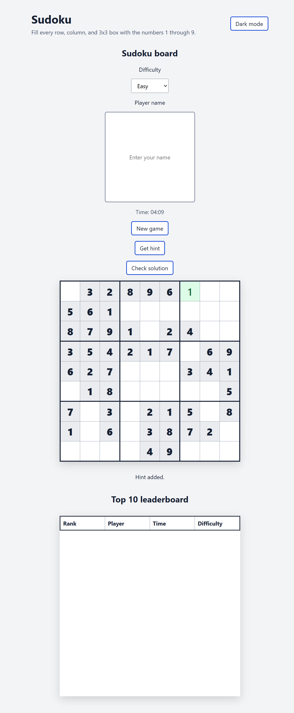

Project: Sudoku Web App
Objective: Build an accessible, responsive Sudoku game using modern CSS and semantic HTML.
Key Features: Multiple difficulty levels, unique-solution puzzles, move validation, hint system, timer, leaderboard, local storage, dark mode toggle, number tracking, Note Mode, and solver animation.
Workflow: Document Copilot prompts and take screenshots of the application structure for the submission instruction file.
Note: Each screenshot shows the application at that development stage; later prompts add features to the earlier implementation.
Prompt templates are also stored in [prompts.json](prompts.json).

Prompt_1: Generate the basic HTML Statement for sudoku board.
Output_Description: Created the initial semantic HTML structure for the Sudoku board, difficulty selector, and game controls.

Prompt_2: Add CSS styling for the sudoku board, include a dark mode toggle and responsiveness to meet accessibility standards.

Output_Description: Added responsive square-board styling, dark mode support, high-contrast colors, and visible focus states.

Prompt_3: Implement the JavaScript logic to generate a playable Sudoku puzzle and populate the grid with initial numbers.

Output_Description: Added randomized backtracking puzzle generation and populated the grid with initial clues. Difficulty-specific puzzle generation was added to the application as it evolved.

Prompt_4: Implement core gameplay features like move validation, hint system, and local storage for saving games. 

Output_Description: Added move validation, incorrect-cell feedback, hints, saved-game restoration, timer persistence, and accessible live status messages.

Prompt_5: Add a hint button that reveals a valid number and a top 10 leaderboard system that saves player names, times, and difficulty in local storage.

Output_Description: Added a functional hint button that reveals, highlights, and locks a correct number. Added an elapsed timer and a top 10 leaderboard that records player names, completion times, difficulty levels, and hint counts in local storage, sorted by fastest completion time.

Conclusion: The Sudoku web app was successfully developed with semantic HTML, responsive CSS, dark mode support, and modular JavaScript. It generates randomized Sudoku puzzles with a verified unique solution across Easy, Medium, and Hard difficulties. Players can enter and validate moves, track used numbers, add candidate notes with Note Mode, receive highlighted and locked hints, watch solver steps, track elapsed time, and restore in-progress games from local storage. Completed games are saved to a top-10 leaderboard with player names, times, difficulty levels, and hint counts. The interface includes keyboard-friendly controls, accessible labels, live status updates, invalid-state announcements, visible focus styles, responsive layouts, reduced-motion support, and accessible number-tool status feedback.
